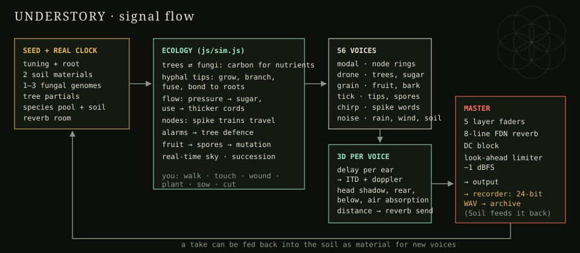

# Understory

**A mycorrhizal sound forest that grows around you.** Every forest begins as bare soil under the real sky of the hour you open it: wind, the soil, a few seeds on the flower of life. What grows there, and in what tuning, is up to the forest. It never stops changing: trees age and fall, gaps open, and over long runs a forest can turn into something else entirely.
- **Seedlings** germinate one by one.
- **Fungal spores** blow in on the wind and wrap the young roots.
- **Trade:** trees and fungi trade carbon for nutrients.
- **Signals and water:** sugar, water and electrical signals move through the hyphae.
- **Fruit:** mushrooms appear after rain, and their spores drift past you and grow into new, mutated individuals.

You hear all of it in 3D. Every seed, every species and every single tree and fungus has a voice of its own. The system runs on its own, and you can walk through it, touch it, wound it, plant in it and cut it. When you leave, it lives on: come back the next morning and it has grown, aged and changed. A field guide names everything living there, with the science behind it and what it sounds like.

It uses the Web Audio API and an AudioWorklet engine, with no build step and no dependencies. It runs in any current desktop browser.



---

## Run it

```bash
git clone https://github.com/<you>/understory.git
cd understory
python3 -m http.server 8080        # or: npm run dev
# open http://localhost:8080
```

Serve the page over `http(s)`, because browsers refuse to load AudioWorklets from `file://`. Use headphones: the default spatial mode is binaural.

### Deploy to GitHub Pages
Push to `main`, and the workflow in `.github/workflows/pages.yml` publishes the repository root. You only need to turn it on once, under **Settings → Pages → Source: GitHub Actions**.

### Single-file build
```bash
npm run build      # → dist/understory.html (self-contained) and dist/artifact.html (for claude.ai artifacts)
```

### Tests
```bash
npm test           # engine stress test: random, dense and extreme voices; checks NaN, ceiling, CPU
npm run test:longrun   # a forest left running for many hours keeps turning over
npm run test:sim   # succession run headless for an hour per seed, printed every 5 minutes
npm run test:scale    # 64 trees and 128 fungi on shaped ground: speed, place-dependence, host specificity
npm run test:away     # the forest living through 8 hours, 3 days and 30 days away: speed, change, health
npm run test:layers   # one grown forest rendered layer by layer: level, peaks and limiter activity
npm run test:events   # every happening in every season, the crowding cap, and a save/restore round trip
npm run test:mix   # ecology + engine together offline; loudness per 10 s (add a layer index 0–4 to solo it)
```

---

## Building a forest

You can let a forest grow on its own, or build a complex one:
- **Scale:** up to **32 trees** and **64 fungal individuals**, with networks of a couple of thousand hyphae.
- **Shape ground** (key 7) paints the conditions of a place: **Wet**, **Dry**, **Rich**, **Acid**, **Stone**, or a **Dead log**.
- **Plant** picks one of eight tree species, or lets the place decide.
- **Sow spores** picks any of 22 fungal genera, or lets the place decide.
- **Underfoot:** the line under the tools describes the ground where you stand, and where your pointer is. For example: "moss on wet, acid soil · deep shade · suits spruce and silver fir".

**Every place is different:**
- **Ground:** each seed has its own terrain (a wet seep, a stony ridge, rich and poor patches).
- **Trees** grow, germinate and survive according to how well the place fits their niche: wetness, acidity, fertility, shade and stone.
- **Fungi** grow and germinate according to their soil preferences, and many decline on nitrogen-rich ground. Host specialists only partner their hosts:
  - *Suillus*: larch and pine
  - *Rhizopogon*: stone pine
  - *Leccinum*: birch
  - *Alnicola*: alder
- **The ground layer follows light and soil:** grass in the open, moss and ferns in moist shade, blueberry heath on acid ground, sedge in bogs, lichen on stone.
  - Dense grass, heath and bracken smother seedlings.
  - Moss softens footsteps and the soil's crackle.
- **The trees change the ground in turn:**
  - Spruce and pine needles acidify the soil.
  - Alder fixes nitrogen and enriches it.
  - Beech and oak litter enrich it slightly.
  - Dead logs rot into rich soil and feed the decomposers.

**Big forests stay listenable:**
- Only the 14 trees you can hear best have a voice at any moment; voices cross-fade as you move.
- The foreground cap thins the forest's own events.

## Time and succession

- **The sky** follows your real clock and date at 1×, computed for an Alpine valley (46.5° N): sunrise, sunset, temperature, night.
- **Time** runs from 0.25× to 24×; at 24× a forest day lasts an hour. **Season** swaps today's date for May, July, October or January.
- **While you are away** the forest lives on. When you come back, it catches up on the time you were gone (up to 30 days of forest life) in a few seconds at a coarser step, and tells you what happened: which trees came up and died, which fungi arrived, storms, beetles. Passing sounds are not simulated while you are away; growth, ageing, death, seed and spore rain, new partnerships, fruiting and the slow drift of voices are.
- **Growth** is compressed, and nothing ends: every tree species has its own lifespan (birch and alder short, stone pine and oak long), so old trees die as snags, light reaches the floor and the next generation takes over. Sound always plays in real time.

| Stage | Typically at 1× | You hear |
|---|---|---|
| Bare soil | 0 min | wind and the soil |
| Germination | ~0.5 min | thin single tones as seedlings appear, an octave up |
| First partners | ~1–6 min | spores drifting in; the first growing tips ticking; root bonds ringing |
| Network | ~5–15 min | signals travelling, sugar gliding between trees, trades at the roots |
| Young forest | ~25 min | fuller trees with more partials; the first mushrooms after rain |
| Closing canopy | ~40 min | late-stage fungi; decomposers; foxfire shimmer at night |
| Old growth | ~60 min | hub trees, thick cords, the full soundscape |

## How it lives

The biology behind each part, with sources, is in [docs/how-it-lives.md](docs/how-it-lives.md). In short:

| Part | What happens | What you hear |
|---|---|---|
| **Trees** | They germinate from a seed bank, make sugar in daylight, shade each other, and grow with sugar, nutrients and water. They drop seedlings of their own kin, who inherit their genotype. | Sustained partials, a plucked strand, breath through a hollow, or bark and water grain, chosen by species and seed. Each tree's voice follows its own genotype, age, ground, nutrients and partners. Thirsty trees click (Khait 2023). |
| **Fungal succession** | Early-stage genera arrive first on the wind, late-stage genera under a canopy, decomposers on litter. Spores germinate only near roots or litter. | New voices enter the mix as the forest develops. |
| **Exploration types** | Contact, short-, medium- and long-distance body plans (Agerer), from dense mats to thick, fast rhizomorph cords. | From fine high ticks to deep, long chirps. |
| **Market** | Fungi forage nutrient patches and deliver to trees. Trees pay carbon in proportion to delivery, and more when nutrient-starved (Kiers 2011). | Soft tones at the roots when nutrients change hands. |
| **Water** | At night, deep-rooted trees pass water through the hyphae to dry seedlings (Querejeta 2003). | A liquid gurgle travelling through the dark. |
| **Hyphae** | Tips take a random walk, turn toward roots, branch, fuse with their own individual into loops (anastomosis) and bond to roots. Different individuals do not fuse. | The tips nearest you tick as they grow. When two individuals meet and wall off, you hear a crackle. |
| **Sugar** | It flows by pressure, from fed trees to shaded ones. Cords that carry it thicken, and unused cords wither and are recycled. | A warm tone travels along the cords and glides from the source tree's pitch to the receiving tree's pitch. |
| **Signals** | Nodes fire spike trains ("words") that travel along hyphae at walking pace and can make the next node fire. Activity rises after rain and in warmth (Fukasawa 2023). | Chirp trains move through space past you, and nodes ring in the species' resonator voice. |
| **Alarms** | A tree browsed by deer, or wounded by you, sends faster and harsher trains. Trees that receive them raise their defence. | The receiving trees grow rougher, brighter and start to tremble, then calm down over time. |
| **Fruit & spores** | Mushrooms are built from the hosts' recent sugar (Högberg 2001) and form at the colony edge after rain, most in autumn. Spores are flicked off by Buller's drop, lifted by the cap's evaporative updraft (Dressaire 2016) and carried on the wind. They can germinate into new, mutated individuals. | A granular bloom; tiny launch clicks; spores passing around you with doppler. |
| **Decomposers** | They break litter down into nutrient patches. Some glow in darkness under circadian control (Oliveira 2015). | A faint shimmer over the litter at night. |
| **Weather** | The real day and night, temperature, rain or snow, fog, drying soil, and wind that turns and gusts. | Rain falls around you, the wind sighs in the crowns (needles whistle at about 0.2 × wind speed ÷ needle width; leaves flutter and rustle), and the soil hums and crackles beneath you. In fog, distant sounds carry. |
| **Birds & animals** | Songbirds arrive once there is a canopy and sing most at dawn. Owls call at night. Woodpeckers drum on standing dead trunks. In summer there are crickets; in the autumn rut, red deer roar. | A sparse layer of calls placed in the treetops around you. |
| **Tree species** | Eight Alpine species: larch, Swiss stone pine, Norway spruce, silver fir, beech, birch, black alder, sessile oak. Each has its own niche, timbre, register and colours. Larch and birch turn gold and stand bare in winter; beech and oak keep dry leaves (marcescence); conifers stay dark. | Bare trees lose their upper partials and breathe with the wind through their branches. |
| **Fungal calendar** | Every genus fruits in its own months: *Hygrophorus* in March at the snowmelt, most genera in late summer and autumn, the velvet shank (*Flammulina*) in winter frost; *Cenococcum* never fruits. Spore rain follows the calendar. | The fruiting voices change with the months. |
| **Seasons** | Winter brings snow, whose cover absorbs sound, and frost cracks in hard frost. Spring has the strongest dawn chorus and a flush of growth. Summer has crickets, fireflies and distant thunder. Autumn has falling leaves, mushrooms and the red deer rut. | The forest sounds different in every season, even with the same seed. |

### Seeds
Every seed is a different forest, and each one sets all of the following:
- a sound world: two of struck wood, glass and ice, taut strands, breath and reed, bronze and bells, clay and earth, blended. It steers which voices its species and individuals get, so each forest has a palette of its own
- a species pool: two early-stage and two late-stage ectomycorrhizal genera plus one decomposer, each with its own exploration type and genome
- the nutrient patches in the soil
- a tuning: just intonation, harmonic series, an equal temperament from 5 to 22 tones, the Bohlen–Pierce tritave, a golden-ratio spiral, or something like slendro or pelog
- a root note
- two generated nature recordings for the soil (knocked bark, rain on needles, a meltwater creek, wind in reeds, ice and glass, distant voices, stridulation, struck stones, a bowed branch, cave drips)
- the trees' partial sets
- the climate
- the reverb room

The seeds lie on the centres of the **flower of life**, which also lies on the forest floor. The seed code is in the URL hash (`#LARCH9`), so a link reopens the same forest.

### Happenings
Nine things that happen in real forests. The forest brings each of them on its own, more often in its season, and you can call any of them yourself. Each button shows a bar while its happening is running.

| Happening | What it does |
|---|---|
| **Call rain / snow** | Wets the soil and boosts the fungi's electrical activity. Below freezing it falls as snow, and the snow cover makes the forest hushed and dry-sounding. |
| **Send deer** | Deer browse a tree. It sends an alarm through the network, and the trees that receive it harden their sound. |
| **Windstorm** | Trunks creak, branches break into litter, and spores are lifted high. A weakened tree may be thrown; its root plate tears open mineral soil, and a seedling comes up in the light gap. |
| **Dry spell** | Ten minutes without rain. Thirsty trees click, water moves from deep roots to seedlings at night, and long-distance fungi with water-carrying cords keep trading while the others falter. |
| **Nutcrackers / jays** | They harvest a seed-bearing tree and bury its seeds in caches. Forgotten caches sprout. The Swiss stone pine depends on nutcrackers; jays plant oak woods. |
| **Squirrel** | Eats a mushroom and digs truffles. The spores pass through its gut and start new fungi near other trees (mycophagy). |
| **Wild boar** | Roots for truffles: turns litter into the soil, tears hyphae, opens bare ground where seeds take, and spreads truffle spores in its dung. |
| **Bark beetles** | Bore into the weakest conifer, drought-stressed spruce first. A strong tree drowns them in resin; a weak one dies and stands as a snag. |
| **Fog** | The air goes still, crowns comb water out of the cloud (fog drip), and distant sounds carry further. |

### Space
- **Headphones 3D:** each ear reads every voice from its own delay line, at its distance to that ear divided by the speed of sound. Interaural time difference and doppler fall out of the geometry. Head shadow, darkening for sources behind and below, air absorption and a distance-dependent reverb send give direction and depth.
- **Speakers stereo:** equal-power panning, with the same distance and depth cues.
- **Distance** scales every distance you hear. **Autopan** turns your head continuously, so the whole field revolves around you.
- **Walk:** Amble, Walk, Run, or Rhythm, which ambles, walks, runs now and then, and walks again (key G). The path meanders, keeps inside the circle and steps around trunks. Footsteps follow the ground: snow, leaves, moss, grass, stone, wet sedge or bare soil.
- **Where you listen**, six options:
  - **Drift** wanders slowly toward whatever is happening.
  - **Ride along** travels with whatever moves through the forest: sugar, water, a spike train, a spore, a squirrel.
  - **Under the soil** puts you among the hyphae. Everything above ground is muffled and dulled through the earth, and the soil's echo shrinks.
  - **Into the canopy** lifts you 11 m up among birds and wind.
  - **Back to centre** returns you to the ground at the centre.
  - **Calm** clears the reverb tails.

### Layers
- **Six layers:** trees; signals & sugar; growth; fruit & spores; weather & soil; birds & animals.
- **Level and shape.** Each layer has a level, and a ⋯ button opens two gentle nudges:
  - Trees: register, tone
  - Signals: pace, register
  - Growth: density, tone
  - Fruit: grain, register
  - Weather: tone, width
  - Birds: activity, distance
- **Nudges are biases, not settings.** Pitches stay in the seed's tuning and the forest keeps choosing and mutating within them. Double-click a nudge to let the forest decide.
- **Change** sets how restless the sound world is:
  - Every 12–25 minutes the tonal centre leans toward a related key and every voice glides there over minutes.
  - A slow timbre tide brightens and darkens the forest.
  - Each fungus's voice mutates a little every few minutes.
- **Crowding is capped:** at most ten foreground events from the forest itself plus a few animal calls sound at once, and spontaneous activity thins out when the forest is busy.

### Forests
Every forest you stay with for two minutes, or keep explicitly, is saved in this browser's IndexedDB with a thumbnail. The save holds the whole living state: every hypha, tree, fungus, seed and nutrient patch, along with your settings and nudges.
- **Autosave** runs every 20 seconds and when you leave the page.
- **Continue** opens a saved forest. Opening the page returns you to the forest you were last in.
- **While you are away the forest waits for you**, but the sky moves on to the real hour.
- **On a phone it keeps playing with the screen off**, like a music player, with play and pause on the lock screen. The forest keeps living while the screen is dark.
- Forests can be renamed and deleted.

### Tools on the forest floor
| Key | Tool | Action |
|---|---|---|
| 1 | Listen | Drag the floor to turn, drag your head to walk, click the floor to walk there |
| 2 | Touch | Click a tree, node or hypha to fire a spike train |
| 3 | Wound | Click a tree to wound it: it sends an alarm |
| 4 | Plant | Click open ground to plant a seedling |
| 5 | Sow spores | Click to start a new, mutated fungal individual |
| 6 | Cut | Drag across hyphae to cut them; click a tree to fell it (it pours its sugar into the network as it dies) |

**Sow a sound** in the Layers panel loads your own recording into the soil, and fruit and bark voices then grow from it. You can also drop an audio file on the forest.

### Archive
- **Record** captures the limiter output as 24-bit stereo WAV into the archive, which lives in this browser's IndexedDB. Each take remembers the seed, the stage, the forest's age and its clock time.
- The player shows the selected take as a waveform: click it to seek.
- **Save** downloads a take as WAV. **Save all as zip** bundles every take with `understory-manifest.json`, which records the seed, tuning and spatial mode of each take.
- **Soil** feeds a take back into the forest as material. **Regrow** plants that take's seed again.

Inside a claude.ai artifact, files go through the platform's save dialog, and WAVs arrive zipped because the dialog doesn't accept `.wav` directly.

---

## Stability by design
- Every filter in the engine is a zero-delay state-variable filter, which stays stable at any frequency and Q.
- 56 voices, with priority-based stealing: trees and weather are never replaced by passing signals.
- Signal cascades die out: there is a firing threshold, a refractory period and a hop limit, and a node passes a signal on with probability below 1.
- The master has a 4 ms look-ahead limiter at −1 dBFS and a hard ceiling at 0.98.
- A NaN or Inf anywhere resets all state and fades back in. **Calm** clears the reverb tails on demand.

`npm test` checks all of this offline.

## Keys
| Key | Action |
|---|---|
| Space | grow / pause |
| N | new seed |
| R | record / stop |
| H | headphones / speakers |
| 1–7 | tools |
| G | walk in rhythm / stop |
| W A S D | walk |
| Q / E | turn |
| Shift-drag or right-drag | tilt the view |
| Wheel | zoom |

## Files
```
index.html                 page markup
css/understory.css         all styles (design tokens at the top, light and dark)
js/engine.js               AudioWorklet: voice pool, generators, 3D spatialiser, FDN reverb, limiter, recorder
js/sim.js                  sky, seeds, tunings, procedural materials, the ecology and its sound mapping
js/app.js                  interface, 3D view, input, recording, archive, file export
tools/build-standalone.mjs single-file build → dist/
tools/stress-test.mjs      offline engine stress test
tools/sim-test.mjs         headless ecology run
tools/mix-test.mjs         ecology + engine offline loudness check
tools/events-test.mjs      happenings, seasons, crowding cap, save/restore
tools/scale-test.mjs       large shaped forest: speed and ecology
tools/load.mjs             loads the browser sources into Node for the tests
docs/how-it-lives.md       the biology and how it maps onto the system
docs/signal-flow.svg       diagram
```

## Browser support
It runs in current Chrome, Edge, Firefox and Safari; AudioWorklet is required. Desktop is recommended. The interface works on a phone, but the engine is CPU-heavy (about a third of one core with all 56 voices).

## License
MIT © 2026 Daniel Bovolon. See [LICENSE](LICENSE).
